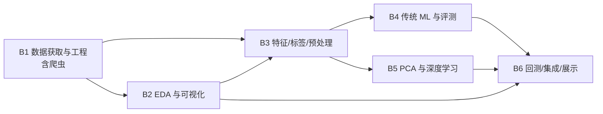

# S&P 500 时序择时 Final Project
## 分析流程与六人分工方案（v0.3 · 两周版）

> **课程**：数据科学开源工具
> **项目类型**：6 人小组 Final Project
> **建议题目**：**从数据到决策：S&P 500 的防泄漏机器学习择时策略（1996–2025）**
> **副标题**：EDA、PCA/Autoencoder 与 DNN/CNN 的完整数据科学实践
> **文档状态**：v0.3，可直接冻结为执行版；组会只需确认第 10 节的 8 个决策
> **可用工期**：**2 周（14 个自然日 / 10 个有效工作日）**
> **人力预算**：**6 人 × 约 8 个有效工作日 = 48 人日 = 46 人日计划 + 2 人日显式缓冲**（已含约 20% 协调与返工折损）
> **默认数据区间**：1996-01-01 至 2025-12-31（30 个完整日历年）
> **默认策略**：周频决策、long/cash、SPY 复权价格（总收益合成价）、单边 5 bps 交易成本

---

## 0. 一页纸摘要

本项目不是"训练一个模型预测股价"这么简单，而是展示一条**完整、可复现、可审计**的数据科学路径：

```text
数据获取与校验 → EDA/可视化 → 特征与标签 → 防泄漏预处理
→ 传统机器学习 + PCA + 深度学习 → 滚动回测 → 风险与收益评估 → 报告/答辩
```

**核心研究问题：**

> 在严格避免前视偏差与数据泄露、并事先注册主模型与主指标的前提下，S&P 500 过去 30 年的量价与宏观信息，对**周频**收益方向与幅度到底有多少**可预测性**？那些看起来"打败了买入持有"的结果，有多少来自**泄漏、选择偏差、成本假设与运气**？

**次级问题（经济层面的追问）：**

> 在扣除交易成本后，基于该预测的 long/cash 策略能否在长期获得优于"买入持有"的**风险调整**收益？

> 这样安排的理由：18 年样本外对 Sharpe 差的统计功效很弱（见 2.4.3），"赢不赢"大概率无法被统计检验确认。把主问题设为"可预测性与偏差归因"，**负结果也是结论**；同时把"经济上是否更优"作为次级问题如实报告，两个层次都成立。

项目最终要回答四个问题：

1. **数据是否可信**：不同来源的 S&P 500 数据是否一致？价格指数与总收益口径是否区分？成分股变更是否说明幸存者偏差？
2. **市场是否可预测**：EDA 中有哪些稳定的收益、波动、回撤和 regime 规律？特征与未来收益的关系是否随时间变化？
3. **模型是否有效**：分类与回归、传统机器学习与 DNN/CNN，在**完全相同的 walk-forward 协议**下，样本外表现谁更好？深度学习在小样本上是否只是过拟合？
4. **策略是否可交易**：扣除成本、考虑换手和现金收益后，收益、Sharpe、最大回撤是否真的改善？结果对成本、阈值、决策规则和训练窗口是否敏感？

**六块分工**（每块一位主责，另有备份）：

| 块 | 工作流 | 主责 | 备份 | 人日 |
|---|---|---|---|---|
| B1 | 数据获取（含爬虫）、清洗、工程与复现 | P1 | P3 | 8.0 |
| B2 | EDA 与可视化叙事（含 PCA 图、**报告合稿**） | P2 | P6 | 8.0 |
| B3 | 特征、标签、预处理与防泄漏 | P3 | P1 | 7.5 |
| B4 | 传统机器学习、决策规则与模型评测 | P4 | P5 | 7.5 |
| B5 | PCA、DNN、CNN、Autoencoder | P5 | P4 | 7.5 |
| B6 | 策略回测与系统集成 | P6 | P2 | 7.5 |
| | | | **计划合计** | **46.0** |
| | | | **缓冲（不分配任务）** | **2.0** |
| | | | **总人力** | **48.0** |

**两周节奏（详见第 7 节）：**

| 阶段 | 日期 | 目标 | 闸门 |
|---|---|---|---|
| S0 | D1 | 冻结口径、建 repo、并行搭骨架 | G0 全组确认 |
| S1–S2 | D2–D5 | 数据面板 v1、爬虫、EDA 主体 | G1 口径与标签冻结（D4） |
| S3–S4 | D3–D6 | 特征、split、泄漏测试、基线 | G2 modeling panel 冻结（D5） |
| S5–S6 | D6–D9 | 全模型 walk-forward、回测、成本 | G3 模型与回测评审（D9） |
| S7 | D10–D14 | 敏感性、报告、slides、预答辩 | G4 报告初稿（D12）、G5 提交（D14） |

**范围纪律（本方案最重要的一张表）：**

| 层级 | 内容 | 人日 |
|---|---|---|
| **核心（必须交付）** | 数据管道 + 爬虫 + 质量报告；EDA 10 图（8 进正文）；22 特征 + walk-forward split + 泄漏测试；LR/HGB 基线；PCA；DNN；CNN；**Autoencoder（3 个代表性折）**；**R1/R2/R4 三种决策规则（含回归 + Kelly）**；回归指标；回测（5/10 bps + 现金）；tearsheet；报告 + slides | **45.0** |
| **拉伸（D1 起默认不做，核心通过 G3 后才可启动）** | Deflated Sharpe Ratio；CNN 窗口长度消融；种子方差扩展 | **1.0** |
| **缓冲（D1 锁定，不分配任务）** | 联调、返工、接口返修、突发缺席 | **2.0** |
| **已扣除（直接进"未来工作"）** | R3 置信度加权（−0.3）；long/short（−0.5）；成本 0/20 bps（−0.25）；子区间 5 段→3 段（−0.25）；CNN 全折 3 种子→1 种子（−0.5）；特征重要性分析（−0.2） | **—（合计 −2.0）** |
| **不做（长期）** | 三分类；日频稳健性；季度重训；DXY 进主模型；AE 全 18 折；5 seeds；横截面因子挖掘 | — |

> 规则一：**拉伸项只有在该块核心交付已通过 G3 后才能启动**；任何"提前做拉伸"的行为都视为进度风险。
> 规则二：**缓冲不是"备用工作量"，不得提前花掉**。D9 之前若计划工作已用满 45 人日，直接进入 7.4 的降级阶梯，不要靠加班补。

---

## 1. 项目定位

### 1.1 研究目标

用 S&P 500 相关数据构建一个**周频战术择时策略**：

- 每周最后一个交易日收盘后，基于截至该时点的信息计算特征；
- 模型输出下周的**收益方向（分类）**或**收益幅度（回归）**；
- 将预测转换为仓位：主策略为 **long/cash**（1 或 0）；long/short 列入未来工作，仅在正文中作为讨论；
- 在下一个交易周的第一个交易日开盘执行；
- 按 walk-forward 方式滚动训练、验证、测试，得到一条完整的样本外净值曲线；
- 与买入持有、200 日均线、逻辑回归等基线比较，并扣除交易成本。

**两条定位要求：**

- **决策规则本身是研究对象**：不只比较"哪个模型预测更准"，还要比较"同样的预测，用哪种规则变成仓位更赚钱"（见 2.3.1）。
- **偏差归因是结论的一部分**：所有"看起来很好"的结果，必须逐一通过 2.6 的负向对照与 4.6.3 的多重比较纪律，否则不得写入摘要。

### 1.2 项目边界

**要做：**

- 数据获取流程简化，但来源、时间戳、校验和、口径必须清楚；
- **用爬虫抓取 S&P 500 成分股变更，用于讨论幸存者偏差**（课程 data scrape 知识点的正式落点）；
- 完整的 EDA 图表和结论，不是"放几张图"；
- 明确区分训练、验证、测试，所有预处理只在训练集拟合；
- 至少覆盖：分类、回归、PCA、DNN、1D CNN、Autoencoder；
- 模型评测既看统计指标，也看经济指标（收益、风险、换手、成本）；
- 比较至少 3 种"预测 → 仓位"的决策规则；
- 对"策略不赚钱"或"深度学习不如基线"的结果如实报告。

**不做：**

- 不做高频交易、不做分钟级数据；
- 不做 500 支成分股的复杂横截面因子挖掘（爬虫只用来说明偏差，不进入回测）；
- 不承诺战胜市场，不根据测试集反复调参；
- 不使用未来数据、不用随机打乱的 K 折交叉验证处理时间序列；
- 不做三分类与日频策略（两周工期装不下，列入未来工作）；
- 不做全 18 折的 Autoencoder 消融（保留 3 折核心交付）；
- **本版不做**：long/short、R3 置信度加权、0/20 bps 成本档、5 段子区间、CNN 全折多种子（均列入未来工作）。

### 1.3 为什么选择周频

- 日频噪声大、换手高，交易成本容易吞掉微弱信号；
- 月频样本太少（30 年约 360 个月），深度学习难以训练；
- 周频约 **1,500+ 个样本**，在信号稳定性、样本量、交易成本之间较平衡；
- 日频可作为未来工作的稳健性检验，**本版不做**（两周工期）。

> 对两周工期的额外意义：周频把样本外测试点压缩到约 940 个、模型重训次数压缩到 18 次，这是能在 10 个工作日内跑完全部实验的前提。

### 1.4 相关工作与定位

报告必须有一节相关工作，否则会被判为"做了个练习"而非"研究了问题"。**只需读摘要 + 结论，4 篇约 1.5 小时**，在 D2–D4 内完成，由 P2 主笔、P4 复核。后两篇（Lo 2004、Bailey & López de Prado 2014）列为**选读**，分别支撑 regime 讨论与 DSR 拉伸项。

| 文献 | 一句话结论 | 对本项目的意义 |
|---|---|---|
| Welch & Goyal (2008), *A Comprehensive Look at the Empirical Performance of Equity Premium Prediction*, RFS | 大量宏观预测变量在样本外**不稳定**，样本内显著、样本外失效 | 我们的"可预测性很弱"是**预期结果**，不是失败 |
| Campbell & Thompson (2008), *Predicting Excess Stock Returns Out of Sample*, RFS | 施加经济约束（如系数符号）可改善样本外表现 | 支持"正则化 + 简单模型"的选择 |
| Gu, Kelly & Xiu (2020), *Empirical Asset Pricing via Machine Learning*, RFS | 树模型与神经网络在**横截面**上有增量 | 说明我们的"单资产时序"设定天生更难，需在局限里承认 |
| Sullivan, Timmermann & White (1999), *Data-Snooping, Technical Trading Rule Performance, and the Bootstrap*, Journal of Finance | 技术规则的"优秀表现"大量来自数据窥探 | **直接支撑 2.6 的预注册与 4.6.3 的多重比较纪律** |
| Lo (2004), *The Adaptive Markets Hypothesis*, Journal of Portfolio Management（选读） | 市场有效性随环境变化，规律会衰减 | 支撑"分 regime / 子区间评估"的设计 |
| Bailey & López de Prado (2014), *The Deflated Sharpe Ratio*（选读） | 多次试验后，Sharpe 需按试验次数折减 | 若做拉伸项，可用 20 行代码实现并作为亮点 |

**我们的差异（报告引言里必须写一句）：**

> 与上述工作相比，本项目的贡献不在新算法，而在于**把"防泄漏"与"防数据窥探"落成可执行的代码与测试**：预注册主模型与主指标、purge/embargo 的时间切分、随机标签与未来特征注入的负向对照、以及成本与决策规则的敏感性分析。我们用一条 30 年的单资产路径，量化"表面超额收益中有多少是偏差"。

---

## 2. 研究设计：先把规则定死

这一节是整份文档最重要的部分。**先定规则，再看结果**，避免"看到测试集后再改口径"。

### 2.1 数据范围与标的

| 数据 | 建议代码/来源 | 用途 | 备注 |
|---|---|---|---|
| S&P 500 交易标的 | **SPY** 原始 OHLCV + Adj Close，Yahoo Finance / Stooq | 主回测、信号、收益 | 用 `Adj Close / Close` 复权因子派生**总收益合成价格**（见下方口径 2） |
| S&P 500 价格指数 | **^GSPC**，Yahoo Finance / Stooq | 交叉校验、展示 | 价格指数不含股息，不能直接代表长期总收益 |
| S&P 500 总收益指数 | **^SP500TR**，Yahoo Finance | **SPY 复权口径的独立对账** | 与 SPY 总收益逐年比对，年化偏差应 < 0.3% |
| 波动率 | **^VIX**，CBOE / Yahoo | 风险与情绪特征 | 1990 年起可用；**一律滞后 1 个交易日**（见口径 6） |
| 美国 10 年期国债收益率 | **DGS10**，FRED | 利率环境、期限利差 | 按发布/可得时间滞后使用 |
| 3 个月国库券收益率 | **DTB3**，FRED | 现金收益、Sharpe 无风险利率 | long/cash 时现金部分按此计息（换算见 2.3） |
| 美元指数（可选） | **DX-Y.NYB** | 宏观/流动性特征 | 拉伸项，不进主模型 |
| NBER 衰退标记 | **USREC**，FRED | EDA 阴影、分时期评估 | 仅用于展示和分组，不作为特征 |
| S&P 500 成分股列表与变更 | **Wikipedia**，`requests` + `BeautifulSoup` / `pandas.read_html` | 幸存者偏差论证、EDA 图 | **正式交付**，不进入回测 |

**数据口径的关键决定：**

1. **主回测使用 SPY 的总收益口径**，而不是 ^GSPC。^GSPC 是价格指数，长期会漏掉约 2%/年的股息，30 年累计差异巨大。
2. **复权价是"总收益合成价格"，不是可成交价。** Yahoo 只直接提供 SPY 的 `Adj Close`，原始 OHLC 不是复权价。必须先计算复权因子 \(f_t = AdjClose_t / Close_t\)，再派生复权 OHLC：
   \[
   O^{adj}_t = O_t \cdot f_t,\quad H^{adj}_t = H_t \cdot f_t,\quad L^{adj}_t = L_t \cdot f_t
   \]
   **必须在报告中写明**：(a) 复权价的收益等价于"分红再投资"的总收益，但历史价格水平不可成交；(b) 由于成本按名义比例（bps）计，这一设定不影响成本口径；(c) **复权只改水平、不改比率**：同一日期的 O/H/L/C 共用同一个因子 \(f_t\)；更关键的是，任意历史日期 \(s\) 的复权价，都等于"在决策日 \(t\) 实时看到的复权价"乘以同一个只取决于 \(t\) 的常数。因此价格/均线、收益率、波动这类比率型特征，与当时实时计算的数值完全一致，不受未来分红影响——这是允许使用复权价的**前提条件**，也正因如此 **4.3 禁止使用价格绝对水平作为特征**。若老师追问，可用原始价 + 除息日现金分红做一次对账（拉伸项，0.5 人日）。
3. **^GSPC 用于交叉校验**：SPY 与 ^GSPC 的日收益相关性应 > 0.99；差异应主要来自股息和费用。
4. **原始数据保存为不可变快照**，记录 `source_url`、`retrieved_at`、`sha256`，不在 Excel 中手工修改。
5. **所有宏观数据按"当时是否可得"处理**：DGS10 / DTB3 来自 H.15，美东时间约 16:15 发布，晚于股票收盘（16:00），因此**至少滞后 1 个交易日**；有条件时使用 ALFRED vintage，本版不强制。
6. **VIX 滞后 1 个交易日**：CBOE 的 VIX 现金指数收盘为 16:15 ET，比股票收盘晚 15 分钟。若用当日 VIX 在收盘后决策，存在 15 分钟的隐性前视。处理方式：**VIX 特征统一 `shift(1)`**，并在数据字典标注理由。代价极小，收益（答辩安全）极大。
7. **数据区间维持 1996-01-01 起**：SPY 自 1993 年起有数据，从 1996 开始会损失约 156 周样本（初始训练集 −30%）。保留 1996 的理由是"30 个完整日历年 + 对齐 VIX 可用的稳定区间 + 两周工期不再增加数据口径分支"。**这是一次有意识的取舍，须在报告的"数据"一节写明**；延到 1993 列为未来工作。
8. **总收益口径的独立对账**：把 SPY 复权序列与 ^SP500TR 逐年比对，年化偏差应 < 0.3%。这是"数据准确"最硬的一条证据，优先级高于"SPY vs ^GSPC 相关性 > 0.99"——后者是两个不同标的，只能抓粗错，抓不到复权因子错误或错位一天。

**数据获取一律脚本化**：`requests` / `yfinance` 带重试、超时、缓存；API 不稳定时用 Stooq CSV 备用；原始文件按 `data/raw/{source}/{ticker}.csv` 只读保存；每次下载生成 `manifest.json`（URL、下载时间、行数、日期范围、SHA256）。

### 2.2 决策时间轴（防泄漏核心）

以"周"为决策单位，设第 \(w\) 周最后一个交易日为 \(t\)：

| 时间 | 动作 | 当时可见的信息 |
|---|---|---|
| 第 \(w\) 周最后交易日收盘 \(t\) | 计算特征、生成信号 | 只使用 \(\le t\) 的数据 |
| 第 \(w+1\) 周第一个交易日开盘 \(t+1\) | 执行仓位 | 使用 \(t+1\) 开盘价成交 |
| 第 \(w+2\) 周第一个交易日开盘 \(t+2\) | 平仓/换仓 | 使用 \(t+2\) 开盘价成交 |

对应标签（**对数收益，只用于建模与画图**）：

\[
r_{w+1}^{oo} = \ln\left(\frac{O^{adj}_{w+2}}{O^{adj}_{w+1}}\right)
\]

- **分类标签**：\(y_w = 1\) if \(r_{w+1}^{oo} > 0\)，否则为 0；主任务为二分类。
- **回归标签**：直接预测 \(r_{w+1}^{oo}\)。
- **执行滞后**：信号在 \(t\) 收盘后生成，\(t+1\) 开盘才交易，避免"用收盘价信号在同一收盘价成交"的前视偏差。
- **回测用简单收益**：同一持有期的简单收益为 \(R_{w+1} = O^{adj}_{w+2}/O^{adj}_{w+1} - 1\)。**建模用对数、回测用简单，两者不可混算**（见 2.3）。

> **周的定义（必须写成代码并测试）**：一周 = 该 ISO 周的**最后一个交易日**（遇节假日提前）。禁止用 `resample('W-FRI')` 直接取标签，因为它在假期周会产生空行或错位；正确做法是先构造 `ISO year-week` 键再取 `.tail(1)`，并对 1996 年第一周与 2025 年最后一周做截断检查。单元测试中至少包含感恩节周、圣诞周、飓风休市周三个用例。

### 2.3 交易规则

**主策略：long/cash**

\[
p_{w+1} =
\begin{cases}
1, & \text{预测为上涨且置信度/预测收益超过阈值} \\
0, & \text{否则}
\end{cases}
\]

- 满仓或空仓，不加杠杆；
- 空仓期间现金按 3 个月国库券收益率计息；
- 周频换仓；
- 单边交易成本基准 **5 bps**，并做 10 bps 敏感性分析（0/20 bps 已从计划中移除）；
- 阈值只能在前述**固定验证区间**上选择，不能看测试集。

**策略周收益：**

\[
1 + R_{p,w+1} = \left(1 + p_{w+1} R_{w+1} + (1 - p_{w+1})\, r_{f,w+1}\right)\left(1 - c\,\lvert p_{w+1} - p_w\rvert\right)
\]

其中：

- \(R_{w+1}\) 为当周简单总收益，\(p_w\) 为上周持仓（首次建仓时 \(p_w = 0\)）；
- \(c\) 为单边成本（5 bps = 0.0005），成本以"对成交名义额的乘性折扣"计入，等价于 `trade_notional × c`；
- \(r_{f,w+1}\) 为现金周收益，**按实际交易天数折算**：
  \[
  r_{f,w+1} = \left(1 + y^{be}\right)^{n_w/252} - 1,\qquad
  y^{be} = \frac{365\, y_d}{360 - 91\, y_d},\qquad y_d = \frac{\text{DTB3}}{100}
  \]
  其中 \(n_w\) 为该持有周的实际交易日数（通常 5，假期周 4），\(y^{be}\) 是把 DTB3 的**银行贴现率**换算成**债券等价收益率**。若嫌麻烦，可改用 FRED 的 `DFF`（联邦基金有效利率）或 `DGS3MO`，但必须在报告中写明口径。
- 净值 \(E_{w+1} = E_w \times (1 + R_{p,w+1})\)，起始 \(E_0 = 1\)。

> **收益口径提醒**：策略收益全程在简单收益空间计算，成本以乘性折扣计入；现金收益按持有周的实际交易日数折算。若把对数收益、现金收益与成本直接相加，或用 `DTB3/252` 当作周收益，都会在答辩时被金融背景的老师当场指出。

**稳健性策略：long/short（本版不做，规则保留备查）**

- 预测上涨 → +1；预测下跌且超过负阈值 → −1；否则 0；
- 必须计入**做空成本**：借券费按 30 bps/年计（周化约 0.6 bps），卖空所得不计息（保守）；
- 用于讨论"做空是否改善风险调整收益"，不作为主结论。

#### 2.3.1 决策规则对比

同样的预测，用不同规则变成仓位，结果可能差很多。**这是"决策"而不只是"预测"的地方**，也是课程要求里最容易被忽略的一环。

| # | 规则 | 定义 | 定位 | 人日 |
|---|---|---|---|---|
| R1 | 固定阈值 | \(p = \mathbb{1}[\hat{P} > 0.5]\) | **主规则（预注册）** | 0（核心） |
| R2 | 分位数阈值 | 阈值取训练集 \(\hat{P}\) 的 60% 分位 | 抗概率漂移 | 0.3（核心） |
| R4 | 回归 + Kelly | \(p = \text{clip}\left(\hat{\mu}/\hat{\sigma}^2 \cdot \kappa, 0, 1\right)\)，\(\kappa\) 在验证集校准 | **把回归模型真正用起来** | 0.5（核心） |
| R3 | 置信度加权 | \(p = \text{clip}\left(\frac{\hat{P}-0.5}{0.5}, 0, 1\right)\)，或离散为 0/0.5/1 | **本版不做，列入未来工作** | — |

> 口径：保留 **R1 / R2 / R4 三种**，恰好满足"至少 3 种决策规则"，同时把回归从"只出指标"变成"真正下单"。

要求：**三种规则（R1/R2/R4）在同一份样本外预测上比较**，输出一张"规则 × (CAGR, Sharpe, MaxDD, 年换手, 交易次数)"的表，并给出"哪种规则在扣费后更优"的结论。R1 为预注册主规则，R2/R4 为对照。

### 2.4 评估协议：扩展窗口 walk-forward

- **选参用训练段**：1996–2005（约 10 年）；
- **验证（仅用于一次性选参）**：2006-01-01 – 2007-12-31；
- **重拟合段**：超参选定后，fold 2008 用 **1996–2007** 重新拟合（含 2006–2007 选参段），因此 `splits.json` 中 fold 2008 的 `train_end = 2007-12-14`。两步合起来构成同一协议；
- **第一个测试年**：2008；
- **滚动方式**：每年向前滚动 1 年，训练窗口扩展（训练集把上一年的验证/测试数据一并纳入）；
- **最终样本外区间**：2008–2025（约 18 年）；
- **purge 间隔**：训练集末端与测试集起点之间留 **2 周**；
- **重训频率**：每个测试年重训一次；
- **测试集只使用一次**：最终结果冻结后，不再根据测试集改模型。

#### 2.4.1 超参与阈值协议

**采用"一次性选参 + 全折冻结"（方案 A）：**

1. 在 1996–2005 上训练、在 2006–2007 上评估，选定**全部超参数、特征集合、决策阈值**；
2. 自此**所有 18 折共用同一组超参数**，不再调整；
3. 唯一随折变化的是模型权重（每年用扩展窗口重训一次）。
4. **深度学习早停集**：早停不使用 2006–2007 选参集——它已并入 fold ≥ 2008 的训练段，再用就是"拿训练内数据早停"，等于没有早停。每折从**该折训练段尾部**切出 2 年作为早停集，与训练部分之间留 2 周 purge；早停集只决定训练轮数，不参与超参、特征或阈值选择。若某折训练段不足以切出 2 年，改用固定 epoch（DNN = 80，CNN = 60）。

**为什么不用"每折重新选参"（方案 B）**：方案 B 更严谨但成本翻倍（超参搜索 × 18 折），两周工期装不下；且 2006–2007 只有约 104 周，逐折选参的噪声本身就很大。**采用方案 A 后，必须在报告的"局限"里写明**：

> 超参数在全样本外区间内固定，未做逐折重选；因此本文的样本外表现代表"一次冻结的建模决策"，而非"每年重新优化的上限"。这一选择降低了选择偏差，但也可能低估了模型在制度变迁下的适应能力。

**同时必须声明**：验证集只有 2006–2007 两年，且这恰好是金融危机前夜，存在"验证期 regime 特殊"的风险。这一点写进"局限"，不掩盖。

#### 2.4.2 purge 与 embargo 的准确口径

- **purge**：训练集中**标签窗口与测试期重叠**的样本必须剔除。本项目的标签跨度是 1 周（\(t+1\) 开盘至 \(t+2\) 开盘），因此 purge ≥ 1 周；
- **实际取 2 周**（1 周标签 + 1 周缓冲），用于覆盖"周五决策、下周一执行"的边界不确定性；
- **embargo** 在本设定下**不需要**：因为训练集永远在测试集之前（扩展窗口），不存在"测试期之后的训练样本"污染测试期起点的问题。把 purge 与 embargo 混为一谈是不准确的术语，此处分开定义；
- **代价核算**：2 周 × 18 折 ≈ 丢掉 36 周，占全样本约 2.3%，可接受；4 周会丢 72 周（4.6%），在两周工期下属于不必要的浪费。

#### 2.4.3 统计功效：这个项目能检测到什么

必须在**看到结果之前**算清楚，否则会把"测不出"误读成"不存在"。

- 样本外约 **940 周 ≈ 18 年**；
- 单条策略年化 Sharpe 的标准误近似为 \(\sqrt{(1 + 0.5S^2)/T}\)。取 \(S \approx 0.6\)、\(T = 18\)：
  \[
  \text{SE}(\hat{S}) \approx \sqrt{\frac{1 + 0.5 \times 0.36}{18}} \approx 0.26
  \]
  即 **95% 置信区间约为 ±0.5**；
- 两条**高度相关**策略（同一标的、同一周频、仓位只在 0/1 之间切换）的 Sharpe 差，其标准误显著小于独立情形；但经验上，**小于约 0.4–0.6 的 Sharpe 差异在本样本长度下不可能被统计检验确认**（精确值由 4.6.2 的配对 block bootstrap 给出）。

**结论（写进报告"方法"一节）：**

> 本项目的样本量足以检测"强信号"（如 Sharpe 相差 0.8 以上），**不足以检测"弱信号"**（如 0.2–0.3 的改善）。因此本文的结论将以"效应量的点估计 + 置信区间 + 经济显著性讨论"为主，不以"是否显著"作为唯一判据；任何小于功效下限的差异，一律表述为"无法区分"，而非"更优"或"更差"。

> 这一段是全案"硕士水准"最直接的体现：**先算功效，再谈结论**。它同时把"策略没赢"从失败变成了设计的必然结果。

### 2.5 十一条防泄漏红线

1. **先切分，再标准化**：scaler、winsorizer、PCA、Autoencoder 只能在训练折上 `fit`。
2. **不随机打乱时间序列**：所有 CV 必须是时间序列 CV 或 walk-forward。
3. **特征选择也在折内**：不能先用全样本相关性挑特征，再切分。
4. **标签对齐执行时点**：\(t\) 的信号只能预测 \(t+1\) 开盘之后可获得的收益。
5. **purge 到位**：标签跨期时，训练集与测试集之间留缓冲（本项目 2 周）。
6. **不用全样本统计量**：均值、方差、分位数、PCA 载荷都不能用未来数据。**唯一例外**：§4.2 的"描述性 PCA"（仅展示载荷与解释方差，不参与特征选择与建模）。
7. **宏观数据按发布滞后**：至少滞后 1 个交易日；**VIX 亦滞后 1 日**。
8. **不在测试集上调参**：包括阈值、模型选择、特征选择、早停。
9. **不用未来函数**：`shift(-1)` 只能用一次来构造标签，绝不能进入特征。
10. **做负向对照**：随机标签应接近 50% 准确率；把特征整体后移应导致策略失效。
11. **EDA 洞察不得直接决定特征集**：EDA 只能提出假设。任何因 EDA 而保留或剔除的特征，都必须在 1996–2005 上复核后才进入 modeling panel；若确需在验证段 2006–2007 比较，则计入 2.4.1 的一次性选参预算，不得反复试。全过程写入 `docs/decisions.md`。

### 2.6 负向对照、预注册与稳健性

**预注册（D1 组会完成，写入 `docs/preregistration.md`）：**

| 项目 | 预注册值 |
|---|---|
| 主模型 | L2 逻辑回归（标准化后 22 特征） |
| 主决策规则 | R1 固定阈值 0.5 |
| 对照决策规则 | R2 分位数阈值、R4 回归 + Kelly |
| 特征集确定规则 | EDA 只提假设；特征集在 1996–2005 上复核后冻结（红线 11） |
| 早停协议 | 每折训练段尾部 2 年（带 2 周 purge），不使用 2006–2007 选参集（2.4.1 第 4 条） |
| 主指标 | 5 bps 成本下的**净 Sharpe（2008–2025，周频，年化）** |
| 主对照组 | 买入持有 SPY（同口径、同成本假设） |
| 次指标 | CAGR、MaxDD、Calmar、年换手、平均仓位、Brier、AUC |
| 成功判据 | 见 2.4.3：以效应量 + 置信区间表述，不以 p 值二分 |

> 预注册的意义：**在结果出来之前把"什么算赢"写死**。之后无论结果如何，报告都以这份文件为准，杜绝"挑一个好看的指标讲故事"。

**负向对照与稳健性：**

- **标签打乱**：AUC 应接近 0.5，策略不应有稳定 alpha；
- **未来特征注入**：故意加入一个未来收益特征，模型应"异常好"，用于验证泄漏检测流程有效（**必须能抓到**，否则说明测试无效）；
- **时间平移**：特征整体滞后/前移，观察性能是否异常；
- **成本敏感性**：5/10 bps；
- **阈值敏感性**：分类概率阈值 0.5/0.55/0.6；
- **子区间**：dot-com、GFC、2023–2025（3 段）；
- **多种子**：DNN 全折 3 种子；CNN 全折 1 种子 + 2008/2018/2022 三折 3 种子；均报告均值 ± 标准差；
- **同等暴露基准**：long/cash 策略的平均仓位通常只有 50–70%，其 Sharpe 与买入持有不可直接比较。**必须额外构造一条"恒定平均仓位"的基准**（如恒定 60% 股票 + 40% 现金，周度再平衡），把"择时能力"从"市场暴露"中剥离出来。这是本方案在方法论上最容易被忽视、也最能加分的一条。

---

## 3. 端到端分析流程



| 阶段 | 对应日 | 关键工作 | 主要产出 | 通过条件（Gate） |
|---|---|---|---|---|
| S0 立项 | D1 | 确认区间、标的、成本、策略口径、预注册 | 本文件 + `docs/preregistration.md` | **G0**：全组确认，任务认领 |
| S1 数据 | D2–D4 | 下载、缓存、校验、周频聚合、爬虫 | 原始数据 + 周频面板 + 数据字典 + 成分股变更表 | 日期唯一、缺失可控、来源可追溯 |
| S2 EDA | D2–D5 | 数据质量、分布、时间序列、regime、特征关系 | EDA notebook + 10 张图（8 进正文） + 结论 | 每张图回答一个明确问题 |
| S3 特征/标签 | D3–D5 | 特征工程、标签、防泄漏预处理、split | 特征字典 + modeling panel + `splits.json` | **G1**（D4）：口径与标签冻结；**G2**（D5）：panel 冻结 |
| S4 基线 | D5–D6 | 买入持有、SMA200、逻辑回归 | 基线结果表 | 与最终模型同口径 |
| S5 模型 | D6–D9 | sklearn、PCA、DNN、CNN、AE（3 折） | 模型结果表 + 图表 | **G3**（D9）：同 split、同指标、多种子 |
| S6 回测 | D8–D11 | 仓位、成本、净值、风险、敏感性、决策规则对比 | tearsheet + 结果表 | 净值与持仓可对账 |
| S7 交付 | D10–D14 | 报告、slides、复现检查、预答辩 | 最终包 | **G4**（D12）：报告初稿；**G5**（D14）：提交 |

---

## 4. 各环节技术方案

### 4.1 数据获取与质量

**获取方式：**

- 用 Python `requests` / `yfinance` 写下载脚本，带重试（指数退避）、超时、缓存；
- **并发下载**：7 个标的用 `concurrent.futures.ThreadPoolExecutor(max_workers=4)` 并发拉取，失败重试 3 次后落盘错误日志；整条数据管道应在 60 秒内跑完；
- 不依赖手工下载；如果 API 不稳定，使用 Stooq CSV 作为备用源；
- 原始文件按 `data/raw/{source}/{ticker}.csv` 保存，只读；
- 每次下载生成 `manifest.json`：URL、下载时间、行数、日期范围、SHA256。

**爬虫：**

| 目标 | 方法 | 产出 | 用途 |
|---|---|---|---|
| Wikipedia "List of S&P 500 companies" 当前成分表 | `pandas.read_html` 或 `requests + BeautifulSoup` | `sp500_components_current.csv` | 指数构成快照 |
| 同页 "Selected changes to the list" 历史变更表 | `BeautifulSoup` 逐表解析 + 正则清洗日期与 ticker | `sp500_changes.csv`（1990–2025） | 计算年度成分股换手 |
| 年度换手图 | matplotlib | `eda_component_turnover.png` | **论证"为何不做横截面因子"**（幸存者偏差），同时是一张 EDA 图 |

**技术要求（直接对应课程 data scrape 周）：**

- 抓取前 `robots.txt` 检查 + 明确 `User-Agent` + 请求间隔 ≥ 1 秒（合规，课程里专门讲过爬虫的法律风险）；
- 页面结构变化要能容错：解析失败时回退到"使用本地快照"，并在报告中说明"数据抓取日期"；
- **正则清洗**：`r"(\w{1,5})\s*[–-]\s*"` 提取 ticker、`datetime.strptime` 规范化日期（命中课程"正则"知识点）；
- 抓取结果只用于**展示与论证**，**不进入回测**（避免把"今天的成分股"套到历史上）。

**质量检查清单：**

- 日期唯一、升序、无重复；
- OHLC 关系：`low <= open/close <= high`；
- 复权价格的连续性与拆股/分红事件是否合理；
- 交易日数量与 NYSE 日历大致一致；
- 缺失值比例、连续缺失长度；
- 极端收益（如 |r| > 20%）是否来自真实危机还是数据错误；
- SPY 与 ^GSPC 的日收益相关性、年度收益差异；
- **SPY 复权序列与 ^SP500TR 的逐年总收益偏差（应 < 0.3%/年）**——作为总收益口径的独立对账；
- 宏观序列的发布频率与缺失（周末/节假日向前填充的规则必须固定）。

**数据字典至少包含：**

| 字段 | 含义 | 单位 | 来源 | 频率 | 缺失处理 |
|---|---|---|---|---|---|
| date | 交易日 | — | 交易所 | 日 | 不填充 |
| open/high/low/close | 复权 OHLC（由原始 OHLC × 复权因子派生） | 美元（合成） | Yahoo/Stooq | 日 | 不填充 |
| adj_close | 复权收盘价（原始字段） | 美元（合成） | Yahoo | 日 | 不填充 |
| volume | 成交量 | 股 | Yahoo | 日 | 0 保留，异常值标记 |
| vix | VIX 收盘，**已滞后 1 日** | 点 | CBOE | 日 | 前向填充，限制天数 |
| dgs10 | 10Y 国债收益率 | % | FRED | 日 | 前向填充，滞后 1 日 |
| dtb3 | 3M 国库券贴现率 | % | FRED | 日 | 前向填充，滞后 1 日 |
| dxy | 美元指数 | 点 | Yahoo | 日 | 前向填充，限制天数 |

### 4.2 EDA 与可视化叙事

EDA 不是"画图"，而是按问题组织。**10 张主图**，其中 8 张进正文、2 张进附录：

| # | 问题 | 图表 | 结论要回答什么 | 位置 |
|---|---|---|---|---|
| 1 | 30 年市场经历了什么？ | 对数价格 + 200 日均线 + NBER 衰退阴影 | 大级别牛熊、危机区间 | 正文 |
| 2 | 回撤有多深、多久恢复？ | 回撤曲线 + 水下时间 | 最大回撤、恢复期 | 正文 |
| 3 | 收益分布是否正态？ | 直方图 + QQ 图 + 偏度/峰度 | 厚尾、极端值 | 正文 |
| 4 | 波动是否聚集？ | 20/60/252 日滚动年化波动 | 波动聚类、regime | 正文 |
| 5 | 收益是否自相关？ | ACF/PACF + Ljung-Box | 线性可预测性很弱 | 附录 |
| 6 | 特征之间是否共线？ | 相关性热力图 + VIF | 是否需要 PCA | 正文 |
| 7 | VIX 与未来收益的关系？ | VIX 分位数 vs 未来 1 周收益 | 非线性/状态依赖 | 正文 |
| 8 | 类别是否平衡？ | 上涨/下跌样本按年统计 | 基线准确率、class weight | 附录 |
| 9 | 指数成分是否稳定？ | **成分股年度换手 + 行业构成演变（爬虫数据）** | 幸存者偏差有多大 | 正文 |
| 10 | 策略最终表现如何？ | 净值、回撤、滚动 Sharpe、换手 | 经济意义（**B6 出图，B2 只负责套用统一风格**） | 正文 |

> **不单独出图的两项**：缺失矩阵并入数据质量报告（B1 交付），特征分位数 IC 图并入 B3 的特征字典附录。**理由：两周工期下，图的价值要按"是否进正文"排序，而不是按"能不能画"排序。**

> **PCA 的两种用法必须分开标注**：
> - **描述性 PCA（B2）**：可用全样本拟合，仅用于碎石图、载荷热力图、解释方差与 PC 时间序列的展示，**不参与特征选择、不进入模型**；
> - **建模 PCA（B5）**：必须在每一折的训练段内 `fit`，与红线 6 一致。
>
> 报告里两张图必须分别加注"descriptive (full-sample)"与"in-fold"，否则会被误读为"用全样本 PCA 选特征"，与红线 6 直接冲突。

**可视化规范：**

- 图表标题用英文，报告正文用中文解释，避免中文字体缺失；
- 统一配色、字号、坐标轴单位、图例（提供 `src/plot_style.py` 统一入口）；
- 每张图必须有 caption：**"这张图回答什么问题 + 一句话结论"**；
- 静态图用 matplotlib/seaborn；不混用风格；
- 所有图由脚本生成，不手工截图。

### 4.3 特征工程

特征分五组，全部只用截至 \(t\) 的信息：

| 组 | 特征 | 经济含义 | 个数 |
|---|---|---|---|
| 动量 | 1/3/6/12 个月收益、12-1 动量 | 趋势延续/反转 | 5 |
| 趋势 | 价格/20/50/200 日均线比、50/200 均线差、均线斜率 | 趋势状态 | 5 |
| 波动/风险 | 20/60 日已实现波动、下行波动、ATR、回撤、underwater days | 风险状态 | 5 |
| 情绪/宏观 | VIX 水平与变化、10Y 收益率变化、10Y-3M 期限利差 | 风险偏好与流动性 | 4 |
| 量能/超买超卖 | 成交量 z-score、RSI14、MACD 柱 | 交易拥挤与反转 | 3 |

合计 **22 个特征**。

**注意：**

- **禁止使用价格绝对水平**：只用比率、收益率、变化率、滚动 z-score。原因见 2.1 口径 2——回权因子对窗口内所有点是同一常数，比率不受未来分红影响，而**价格水平会**。
- 所有滚动窗口只向后看；
- 对极端值做 winsorize，但阈值必须来自训练集；
- 特征字典记录：名称、公式、窗口、经济含义、方向预期、缺失处理。

### 4.4 预处理

**标准流程（每个训练折内独立执行）：**

```text
原始特征
→ 缺失值处理（按字典规则）
→ 极端值 winsorize（训练集 1%/99% 分位）
→ 标准化 / 归一化（训练集拟合）
→ 可选：PCA / Autoencoder 降维
→ 模型
```

- **标准化**：`StandardScaler`，用于线性模型、PCA、DNN；
- **归一化**：`MinMaxScaler`，用于 CNN 与 Autoencoder 的输入（网络对输入范围敏感）；
- **消融实验**：在 CNN 上做一次 **`StandardScaler` vs `MinMaxScaler`** 的对比（同一 split、同一 seed、3 seeds 取均值），输出一张两行的小表。成本约 0.3 人日，直接回应课程里"标准化、归一化"并列的要求，并给出"哪种缩放更适合神经网络输入"的实证结论；
- 树模型不需要标准化，但为了统一 pipeline，可以保留；
- PCA：在训练集 `fit`，选择解释 90% 方差的主成分数；
- Autoencoder：只在训练集训练，瓶颈层作为特征；早停集按 2.4.1 第 4 条（本折训练段尾部 2 年），不碰 2006–2007 选参集；
- 类别不平衡：优先 `class_weight='balanced'`，**不要在时间序列上直接 SMOTE**；
- 缺失值：优先前向填充 + 缺失指示变量，避免用全样本均值。

### 4.5 模型矩阵

| 层级 | 模型 | 目的 | 优先级 |
|---|---|---|---|
| 基线 | 买入持有、恒定 60% 仓位、SMA200、始终做多 | 判断模型是否真的有增量 | 核心 |
| 线性 | 逻辑回归（L2）、Ridge 回归 | 可解释、抗过拟合 | 核心 |
| 树模型 | Random Forest、HistGradientBoosting | 非线性、特征交互 | 核心 |
| 降维 | PCA + 逻辑回归/Ridge | 共线性处理、课程知识点 | 核心 |
| 深度学习 | DNN、1D CNN | 非线性表示学习、序列形态 | 核心 |
| 深度学习 | Autoencoder + 分类器 | 非线性降维，与 PCA 对比 | **核心（仅 3 折）** |

> 所有使用滚动窗口的模型（CNN、Autoencoder、DNN）都必须保证：**窗口的最后一个观测值 ≤ 决策时点 \(t\)**，且窗口不跨越 train/test 边界。边界处的样本直接丢弃，不能靠填充把窗口"接起来"。

**DNN：**

- 输入：最新一周的 22 个特征；
- 结构：2 个隐藏层（64→32），ReLU、Dropout 0.3、BatchNorm；
- 输出：二分类 sigmoid（主）或回归 linear（拉伸）；
- 早停：**本折训练段尾部 2 年（带 purge）的 AUC**，patience = 10（协议见 2.4.1 第 4 条）；
- 参数量控制在 5,000 以内。

**1D CNN：**

- 输入：过去 **20 周**的窗口 × 22 特征；
- 结构：Conv1D(16) → Conv1D(32) → GlobalMaxPooling → Dense；
- 目的：捕捉局部时序形态；
- 注意：样本只有约 1,500，CNN 不能太深；**先跑单折确认收敛，再上全折**。
- **种子协议**：全 18 折用 1 个固定种子；只在 2008 / 2018 / 2022 三折额外跑 3 个种子报告方差。理由：CNN 的方差主要来自初始化与窗口裁剪，三折足以说明量级，全折 3 种子不增加信息量。
- **止损点**：D6 结束若单折仍不收敛，直接把 CNN 降级为"附录单折实验"，主结论只保留 DNN；不得拖到 D9。

**Autoencoder：**

- 输入：最新 22 维特征向量；
- 瓶颈：4–8 维；
- 训练：只重构训练集，早停集同 2.4.1 第 4 条；
- 用法：瓶颈特征 + 逻辑回归，与 PCA + 逻辑回归对比；
- **范围：只在 3 个代表性折（2008、2018、2022）上跑**，用于"PCA 线性 vs AE 非线性"的定性对比，**不做全 18 折**。全折 AE 约需 1.5–2 人日算力与调试；但 AE 是课程明确要求的知识点，**3 折版属于核心交付，不能砍**，L3 降级时最多减到 1 折并如实注明。

**算力与时间预算：**

| 实验 | 折数 | 种子 | 运行次数 | 单次估计 | 合计 |
|---|---|---|---|---|---|
| LR / Ridge / RF / HGB | 18 | 1 | 72 | < 3 s | < 5 分钟 |
| DNN | 18 | 3 | 54 | 10–30 s | 10–30 分钟 |
| 1D CNN | 18（1 种子）+ 3 折 × 3 种子 | 1 / 3 | 27 | 20–60 s | 10–27 分钟 |
| Autoencoder | 3 | 3 | 9 | 20–40 s | 3–6 分钟 |
| 回测与 bootstrap | — | — | — | — | < 5 分钟 |

> 全部实验可在 **一台普通笔记本 CPU 上 2 小时内跑完**。这是能在两周内完成的硬性前提：**任何单次训练超过 5 分钟的超参数组合，一律移出搜索空间**。

### 4.6 模型评测

**预测层指标：**

- 分类：Accuracy、Balanced Accuracy、Precision、Recall、F1、ROC-AUC、Brier Score、Log Loss；
- **必须报告 always-long / 多数类基线**：S&P 长期上涨，周度上涨样本可能略多于下跌样本（约 55–57%），单纯 Accuracy 会被"一直猜涨"抬高；因此 Balanced Accuracy、AUC 与经济指标比 Accuracy 更重要；
- 回归：RMSE、MAE、R²、Spearman IC、方向准确率；
- 校准：校准曲线、可靠性图；
- 混淆矩阵：按测试年汇总。

**策略层指标（更重要）：**

- 年化收益（CAGR）、年化波动；
- Sharpe、Sortino（**Sharpe 一律用超额收益计算，分子扣无风险利率，与现金计息口径一致**）；
- 最大回撤（Max Drawdown）、Calmar；
- 胜率、盈亏比；
- 年换手率、平均仓位、交易次数；
- 相对 S&P 500 的 Alpha、Beta、信息比率；
- **相对"恒定平均仓位"基准的超额**；
- 分年度/分 regime 表现；最差 12 个月、回撤恢复时间。

#### 4.6.1 最大回撤的计算口径

周频净值会**系统性低估**回撤（2020 年 3 月的日内跌幅看不到）。处理：

- **报告用日频净值算 MDD**：周内持仓保持上周决策不变，用日频复权价滚动，得到日频净值曲线，再算 MDD；
- 这只影响**报告展示**，不参与任何调参或模型选择，**不构成泄漏**；
- 表格中同时给出"周频 MDD"与"日频 MDD"，并注明差异原因。

#### 4.6.2 统计不确定性

- 对周频收益做 **block bootstrap（block = 8 周，5,000 次）**，给 Sharpe 和 CAGR 的 95% 置信区间；
  - 说明：不要用年度收益做 bootstrap（只有 18 个观测，置信区间会宽到无意义）；
- **配对 bootstrap**：策略与基准的**差值**序列做 bootstrap，给出"Sharpe 差"的置信区间。这是 2.4.3 功效分析的实际执行方式，也是判断"是否真的更好"的正确工具；
- 明确声明：单条历史路径不能证明策略未来有效。

#### 4.6.3 多重比较与选择偏差

项目会跑 **约 12 个模型 × 3 种决策规则 × 2 档成本 × 3 个阈值**——这是上百个结果。若最后挑最好看的那个讲故事，等于自己做了 data snooping（见 1.4 的 Sullivan et al. 1999）。纪律如下：

1. **预注册优先**：摘要与结论**只能**基于 `docs/preregistration.md` 里的主模型 + 主规则 + 主指标；
2. **全表披露**：其余所有结果必须进附录的完整结果表，**不得只报最好的**；
3. **差值而非排名**：所有模型比较以"与买入持有的差值 + 置信区间"呈现，不做"排行榜"；
4. **可选加分**：用 Bailey & López de Prado 的 **Deflated Sharpe Ratio** 对主结果做一次折减（约 20 行代码），并报告"考虑试验次数后的 Sharpe"。做了就是加分项，不做不扣分。

### 4.7 回测

- **输入**：每个测试年的周频预测（`predictions.parquet`）；
- **仓位**：分类概率/回归预测 → 决策规则（R1/R2/R4）→ 仓位 \(p \in \{0,1\}\) 或 \([0,1]\)；
- **收益**：当周 open-to-open **简单**收益 × 仓位 + 现金收益 − 成本（公式见 2.3）；
- **现金**：按 2.3 的 \(r_{f,w+1}\) 计息，使用**实际交易日数** \(n_w\)；
- **成本**：\(c \times \lvert p_{w+1} - p_w \rvert\)，以乘性折扣计入；
- **输出**：`trades.csv`、`equity_curve.csv`、`metrics.csv`；
- **对账**：净值曲线必须能由持仓和收益**逐行复算**（写一个 `tests/test_backtest_reconcile.py`，用 10 行数据手工核对）；
- **图表**：净值（log scale）、回撤、滚动 1 年 Sharpe、年度收益、换手、仓位。

---

## 5. 六人分工

> 原则：**每块一位主责 + 一位备份**；主责不是"一个人做完"，而是对该块的交付质量和进度负责。所有人都要参与报告和答辩，不能只做代码。
> **两周版本的关键约束**：每块人日已含 **0.5–1.0 人日的报告/slides 撰写**（合稿另计 1.0 人日，在 B2）；所有人 D6–D7 与 D10–D12 必须预留写报告的时间。

### 5.1 分工总览

| 块 | 主责 | 备份 | 核心任务 | 主要交付 | 人日 |
|---|---|---|---|---|---|
| B1 数据与工程 | P1 | P3 | 下载、清洗、爬虫、面板、repo、复现 | 数据 + 数据字典 + 成分股变更表 + 一键运行 | 8.0 |
| B2 EDA 与可视化 | P2 | P6 | 探索、图表、叙事、PCA 可视化、**报告合稿** | EDA notebook + 10 张图 + 报告定稿 | 8.0 |
| B3 特征与防泄漏 | P3 | P1 | 特征、标签、split、泄漏测试 | 特征面板 + split + 测试套件 | 7.5 |
| B4 传统 ML 与评测 | P4 | P5 | 基线、sklearn、R1/R2/R4、指标、校准 | ML 结果 + 评测框架 + 决策规则对比 | 7.5 |
| B5 PCA 与深度学习 | P5 | P4 | PCA、DNN、CNN、AE（3 折） | DL 结果 + 消融实验 | 7.5 |
| B6 回测与集成 | P6 | P2 | 回测、成本、集成、答辩主讲 | tearsheet + 可复现 pipeline | 7.5 |
| | | | | **计划合计** | **46.0** |
| | | | | **缓冲（不分配任务）** | **2.0** |

> 46 人日计划 + 2 人日缓冲 = 48 人日 = 6 人 × 2 周 × 约 4 个有效工作日/周，已扣除约 20% 的协调、返工与等待成本。**缓冲在 D1 锁定、不分配任务**；若组员实际投入低于每天 4 小时，直接进入 7.4 的降级阶梯，不要等到 D9。

**成员确认表（组会填写）：**

| 代号 | 姓名 | 主责块 | 备份块 | 负责的报告章节 | 负责的 slides |
|---|---|---|---|---|---|
| P1 |  | B1 数据与工程 | B3 | 数据与复现 | 问题/数据/复现 |
| P2 |  | B2 EDA 与可视化 | B6 | EDA + 相关工作 + **合稿定稿** | EDA 故事 + 统稿 |
| P3 |  | B3 特征与防泄漏 | B1 | 方法：特征/标签/泄漏 | 特征与防泄漏 |
| P4 |  | B4 传统 ML 与评测 | B5 | 传统 ML 与评测 | ML 结果 |
| P5 |  | B5 PCA 与深度学习 | B4 | PCA/DL | PCA/DL 与消融 |
| P6 |  | B6 回测与集成 | B2 | 策略/结论/局限（**不含合稿**） | 回测/结论/主讲 |

> 备份不是挂名：**每块在 D5 与 D9 各做一次 15 分钟的交叉交接**，确保任何一人缺席时，备份能在 2 小时内接手。

### 5.2 各块任务卡

#### B1｜数据获取、清洗、工程复现与爬虫（P1，8 人日）

**负责的问题**：数据从哪里来？口径是否一致？成分股变更说明什么？别人能否一键复现？

**任务（按人日拆分）：**

| # | 任务 | 人日 |
|---|---|---|
| 1 | 建 repo 骨架：`src/`、`notebooks/`、`data/raw`、`data/processed`、`reports/figures`、`tests/`、`docs/` | 0.5 |
| 2 | 下载脚本（7 标的，线程池并发 + 重试 + 缓存） | 1.0 |
| 3 | 清洗与复权：`AdjClose/Close` 因子 → 复权 OHLC；周频聚合；数据字典 | 1.5 |
| 4 | **爬虫**：Wikipedia 成分股当前表 + 历史变更表（含正则清洗、robots 检查、快照回退） | 1.5 |
| 5 | 数据质量报告：缺失、重复、OHLC 关系、极端值、SPY vs ^GSPC、**成分股年度换手图** | 1.0 |
| 6 | `manifest.json`（URL / 时间 / 行数 / SHA256）与不可变快照 | 0.5 |
| 7 | 环境文件（`requirements.txt`）与一键运行脚本；在另一台机器上复现一次 | 1.0 |
| 8 | 撰写报告"数据"章节 + slides"数据/复现"页 | 1.0 |
| | **合计** | **8.0** |

**交付：**

- `src/data_download.py`（并发下载）、`src/data_clean.py`、`src/scrape_wiki.py`；
- `data/raw/*`、`data/processed/weekly_panel.parquet`、`data/raw/wiki/sp500_changes.csv`；
- `docs/data_dictionary.md`、`reports/data_quality.md`；
- `reports/figures/eda_component_turnover.png`；
- `README.md` 的"如何复现"部分。

**验收（G1 / G2）：**

- 从干净环境运行一条命令可重建面板，耗时 < 5 分钟；
- 日期唯一、排序正确、1996–2025 覆盖完整；
- 关键字段缺失率 < 0.5%（宏观前向填充后）；
- SPY 与 ^GSPC 日收益相关性 > 0.99；
- 所有原始文件有来源和校验和；
- **爬虫产出 ≥ 200 条历史成分股变更记录，且能画出年度换手图**。

#### B2｜EDA 与可视化叙事（P2，8 人日）

**负责的问题**：这 30 年市场发生了什么？指数构成稳定吗？哪些规律值得建模？哪些图能讲清故事？

**任务（按人日拆分）：**

| # | 任务 | 人日 |
|---|---|---|
| 1 | EDA 问题清单 + 图表规范 + `src/plot_style.py` 统一风格 | 0.5 |
| 2 | 市场历史图（对数价格 / 均线 / 衰退阴影 / 回撤 / 水下时间） | 1.5 |
| 3 | 分布与波动（直方图 + QQ + 滚动波动 + ACF） | 1.0 |
| 4 | 关系图（相关性热力图 + VIF + VIX 分位 vs 未来收益） | 1.0 |
| 5 | 成分股换手与行业演变图的**叙事化改造**（与 B1 协作） | 0.5 |
| 6 | **PCA 可视化（描述性，全样本拟合，仅展示）**（碎石图、载荷热力图、PC 时间序列）——全样本拟合不参与特征选择与建模 | 1.0 |
| 7 | 撰写 `eda_findings.md`（每图一个问题 + 一句结论），并提炼 3–5 条**假设**交 B3 在 1996–2005 上复核 | 1.0 |
| 8 | 撰写报告"EDA"章节 + "相关工作"章节（**4 篇**） + slides"EDA 故事"页 | 0.5 |
| 9 | **报告合稿**：统一数字口径、图表风格、页数（13–16 页），整合六人章节并定稿 | 1.0 |
| | **合计** | **8.0** |

**交付：**

- `notebooks/01_eda.ipynb`；
- `reports/figures/eda_*.png`（共 10 张）；
- `reports/eda_findings.md`；`reports/related_work.md`（4 篇文献摘要）；
- 图表风格说明；
- **`reports/final_report.pdf` 定稿**。

**验收：**

- 10 张主图全部有标题、单位、caption，其中 8 张标注为"进正文"；
- 不使用未来数据；描述性 PCA 图必须标注 "descriptive (full-sample)"；
- 图中发现的 3–5 条**假设**被 B3 在 1996–2005 上复核（在 `docs/decisions.md` 留痕）；
- 报告中的 EDA 章节可直接复用；
- **合稿后全文数字与 `metrics.csv` 一致，页数 ≤ 16**。

#### B3｜特征、标签、预处理与防泄漏（P3，7.5 人日）

**负责的问题**：什么信息在决策时点真正可得？如何把"不能泄漏"变成可执行的代码和测试？

**任务（按人日拆分）：**

| # | 任务 | 人日 |
|---|---|---|
| 1 | 与 B4/B6 确认标签、执行时点、持有期；写 `docs/preregistration.md` | 0.5 |
| 2 | 特征工程：22 个特征（动量/趋势/波动/宏观/量能），全部比率型 | 2.0 |
| 3 | 标签：下周 open-to-open 对数收益 + 二分类标签；周键定义与单元测试 | 0.5 |
| 4 | walk-forward split：扩展窗口、2 周 purge、`splits.json` | 1.0 |
| 5 | 防泄漏 pipeline：缺失、winsorize、scaler、PCA/AE 全部折内 `fit` | 1.5 |
| 6 | **泄漏测试套件**（见下） | 1.0 |
| 7 | 特征字典、缺失处理说明 | 0.25 |
| 8 | 撰写报告"方法：特征/标签/防泄漏"章节 + slides | 0.75 |
| | **合计** | **7.5** |

**泄漏测试（`tests/test_leakage.py`，必须全部通过）：**

1. 特征不使用未来数据：把原始日频数据截断到 \(t\)，重算特征，结果必须与全量计算一致；
2. 标准化只在训练集 fit：训练折的 scaler 均值必须与全样本均值不同（反向验证：若相同，说明误用了全样本）；
3. 标签 shift 正确：构造人造序列验证 `label = f(t+1, t+2)`；
4. 随机标签负向对照：AUC ∈ [0.45, 0.55]；
5. 未来特征注入必须被检出（AUC 应接近 1.0，说明检测流程有效）。

**验收：**

- 所有特征在 \(t\) 时点可计算（截断测试通过）；
- 所有预处理在折内 fit；
- 泄漏测试 5 项全部通过；
- B4/B5 可以直接用同一份 panel 和 split 跑模型；
- 标签分布、缺失率、特征量纲有报告；
- **红线 11 的复核留痕**：每条 EDA 假设的复核区间（1996–2005）、方法、结论已写入 `docs/decisions.md`。

#### B4｜传统机器学习、决策规则与模型评测（P4，7.5 人日）

**负责的问题**：不偷看测试集的前提下，传统模型能否提供稳定增量？同样的预测，哪种决策规则更赚钱？如何公平比较？

**任务（按人日拆分）：**

| # | 任务 | 人日 |
|---|---|---|
| 1 | 基线：买入持有、**恒定 60% 仓位**、SMA200、始终做多 | 1.0 |
| 2 | 模型：L2 逻辑回归（主）、Ridge、RF、HistGradientBoosting | 1.0 |
| 3 | 统一 walk-forward 训练/验证/测试循环（复用 B3 的 `splits.json`） | 1.0 |
| 4 | 超参与阈值：**2006–2007 一次性选定后冻结**，记录搜索空间与选中值 | 1.0 |
| 5 | **决策规则对比**：R1 固定阈值、R2 分位数阈值、**R4 回归 + Kelly（核心）** | 1.25 |
| 6 | 评测框架 `evaluate.py`：分类指标 + 校准 + 混淆矩阵 + 配对 bootstrap | 1.0 |
| 7 | 回归：RMSE、MAE、R²、IC、方向准确率 | 0.5 |
| 8 | 特征重要性/系数分析（压缩） | 0.25 |
| 9 | 撰写报告"传统 ML 与评测"章节 + slides | 0.5 |
| | **合计** | **7.5** |

**验收：**

- 所有模型使用完全相同的 split；
- 测试集没有参与调参（检查 `docs/preregistration.md` 与代码）；
- 至少一个基线 + 三个 sklearn 模型；
- 结果表含均值、标准差/置信区间；
- 决策规则对比表包含 CAGR / Sharpe / MaxDD / 年换手 / 交易次数；
- **R4 的 Kelly 缩放系数 \(\kappa\) 在验证段校准后冻结，回归策略与分类策略同表比较**；
- 能解释"为什么选这个模型"。

#### B5｜PCA、DNN、CNN 与 Autoencoder（P5，7.5 人日）

**负责的问题**：降维和非线性模型是否带来真实增量？深度学习在小样本金融数据上是否过拟合？

**任务（按人日拆分）：**

| # | 任务 | 人日 |
|---|---|---|
| 1 | PCA 建模：折内标准化 → PCA → 选择主成分数（图由 B2 出，本块只出结果表） | 1.0 |
| 2 | PCA + 逻辑回归，与全特征 LR 对比 | 0.5 |
| 3 | DNN：2 隐藏层，Dropout/BatchNorm，早停，3 seeds | 2.0 |
| 4 | 1D CNN：20 周窗口，Conv1D + GlobalMaxPooling，**全折 1 种子 + 3 折 3 种子** | 1.25 |
| 5 | **标准化 vs 归一化消融**（CNN 输入） | 0.3 |
| 6 | Autoencoder：瓶颈 4–8 维，**仅 3 折（核心）**，瓶颈特征 + LR，与 PCA 对比 | 1.0 |
| 7 | 训练曲线、架构图、参数量、运行时间记录 | 0.5 |
| 8 | 撰写报告"PCA/DL"章节 + slides"PCA/DL 与消融"页 | 0.75 |
| 9 | （拉伸）种子方差、窗口长度消融 | 0.2 |
| | **合计** | **7.5**（核心 7.3 + 拉伸 0.2） |

**验收：**

- 所有降维/预训练只在训练折内完成；
- 种子协议：DNN 全折 3 种子；CNN 全折 1 种子 + 3 个代表折 3 种子；均报告均值与标准差；
- 参数量与样本量匹配，训练/测试差距有量化（过拟合诊断）；
- 与 B4 的结果可直接横向比较（同一 `splits.json`、同一 `evaluate.py`）；
- **若 DL 不如基线，能给出合理解释（样本量、信噪比、非平稳性）**——这是本块的核心结论之一，不是失败。

#### B6｜策略回测与系统集成（P6，7.5 人日）

**负责的问题**：预测如何变成可交易策略？扣费后是否真的有长期收益？如何把六个块讲成一个完整故事？

**任务（按人日拆分）：**

| # | 任务 | 人日 |
|---|---|---|
| 1 | 回测引擎：仓位、open-to-open 简单收益、现金计息、乘性成本、逐行对账测试 | 2.5 |
| 2 | 将 B4/B5 的预测统一为 `predictions.parquet` | 0.5 |
| 3 | 生成 `trades.csv`、`equity_curve.csv`、`metrics.csv` | 0.5 |
| 4 | 策略 tearsheet：净值、回撤（周频 + 日频）、滚动 Sharpe、年度收益、换手、仓位 | 1.5 |
| 5 | 与买入持有、恒定 60% 仓位、SMA200 比较 | 0.5 |
| 6 | 子区间分析：dot-com、GFC、2023–2025（3 段） | 0.25 |
| 7 | 成本（5/10 bps）与阈值（0.5/0.55/0.6）敏感性 | 0.25 |
| 8 | 集成 pipeline：一条命令从数据到最终图表 | 1.0 |
| 9 | 撰写报告"策略/结论/局限"章节、向 P2 提交合稿要点、参加预答辩 | 0.5 |
| | **合计** | **7.5** |

**验收：**

- 净值与持仓**逐行对账**（单元测试通过）；
- 成本、现金收益（含交易日数）、换手计算正确；
- 所有图表可由脚本重建；
- 报告和 slides 口径一致（数字必须来自同一份 `metrics.csv`）；
- **向 P2 提交的合稿包包含：指标表、图表清单、每张图的一句话结论、数字来源路径**；
- 15 分钟答辩演练通过。

### 5.3 RACI（谁负责、谁批准、谁协作、谁知会）

> R = Responsible（执行），A = Accountable（最终负责），C = Consulted（协作），I = Informed（知会）。

| 交付物 | P1 | P2 | P3 | P4 | P5 | P6 |
|---|---|---|---|---|---|---|
| 数据面板 / 数据字典 / 爬虫 | **A/R** | C | C | I | I | I |
| EDA 报告与图表 | C | **A/R** | C | I | I | C |
| 特征/标签/split/泄漏测试 | C | C | **A/R** | C | C | I |
| 传统 ML 与决策规则结果 | I | C | C | **A/R** | C | I |
| PCA/DL 结果 | I | C | C | C | **A/R** | I |
| 回测与策略结果 | I | C | C | C | C | **A/R** |
| 最终报告（合稿与定稿） | C | **A/R** | C | C | C | C |
| 答辩 slides（统稿） | C | **A/R** | C | C | C | C |
| 答辩主讲与串场 | C | C | C | C | C | **A/R** |
| 仓库复现检查 | **A** | I | C | C | C | R |
| 预注册文件 | C | C | **A/R** | C | C | C |

**答辩分工建议（每人 2–2.5 分钟，合计 15 分钟）：**

1. P1：问题、数据、爬虫与复现（2.5 分钟）
2. P2：EDA 故事与关键发现（2.5 分钟）
3. P3：特征、标签、防泄漏（2.5 分钟）
4. P4：传统 ML 与决策规则对比（2.5 分钟）
5. P5：PCA/DL 与消融（2.5 分钟）
6. P6：策略回测、结论、局限（2.5 分钟）

### 5.4 课程外方法的学习责任

下表中的方法**课程没有教**，但已经写进了核心交付。必须指定责任人和补齐日期，否则会变成排期表上看不见的 1–2 人日。

| 方法 | 用在哪 | 负责人 | 补齐日期 | 验收方式 |
|---|---|---|---|---|
| DTB3 贴现率 → 债券等价收益率 | §2.3 现金收益 | P6 | D2 | 手算 3 个日期与代码结果一致 |
| ISO 周键与节假日边界 | §2.2 标签 | P3 | D3 | 感恩节/圣诞/飓风休市三个单测通过 |
| purge / embargo 语义 | §2.4.2 | P3 | D3 | 在 `docs/decisions.md` 写一段自证 |
| block bootstrap 与 Lo 的 Sharpe 标准误 | §4.6.2 | P4 | D4 | 用已知分布做一次模拟校准 |
| 配对 bootstrap 的差值 CI | §4.6.2 | P4 | D5 | 输出一张差值分布图 |
| Kelly 缩放与 \(\kappa\) 校准 | R4 | P4 | D5 | 与固定阈值在同一 split 上对比 |
| PyTorch 1D CNN 与窗口裁剪 | §4.5 | P5 | D3 | 单折 loss 正常下降 |
| Deflated Sharpe（拉伸） | §4.6.3 | P4 | D8 | 20 行实现 + 与普通 Sharpe 对比 |

> 规则：**补齐日期前必须写出可复现的最小示例**，不能"边做边猜"。这一条是给两周工期的保险，不是给老师看的。

---

## 6. 协作规范与接口

### 6.1 仓库结构

```text
sp500-final/
├── README.md
├── requirements.txt
├── config.yaml
├── data/
│   ├── raw/                 # 原始快照，只读（含 wiki/）
│   ├── staging/             # D1–D2 先行数据，只验证管道
│   └── processed/           # 周频面板、split、预测
├── src/
│   ├── data_download.py     # 并发下载 + 重试 + 缓存
│   ├── data_clean.py
│   ├── scrape_wiki.py       # 成分股变更（爬虫）
│   ├── features.py
│   ├── labels.py
│   ├── splits.py
│   ├── models_ml.py
│   ├── models_pca.py
│   ├── models_dl.py
│   ├── decision.py          # 决策规则 R1/R2/R4
│   ├── backtest.py
│   ├── evaluate.py
│   ├── plot_style.py        # 统一图表风格
│   └── pipeline.py
├── notebooks/
│   ├── 01_eda.ipynb
│   ├── 02_ml_models.ipynb
│   └── 03_pca_dl.ipynb
├── tests/
│   ├── test_data_quality.py
│   ├── test_leakage.py
│   └── test_backtest_reconcile.py
├── reports/
│   ├── figures/
│   ├── data_quality.md
│   ├── eda_findings.md
│   ├── related_work.md
│   ├── model_results.csv
│   ├── backtest_tearsheet.html
│   └── final_report.pdf
├── slides/
│   └── final_presentation.pptx
└── docs/
    ├── data_dictionary.md
    ├── feature_dictionary.md
    ├── preregistration.md
    ├── decisions.md
    └── project_plan.md
```

### 6.2 数据契约（先定 schema，再并行开发）

**`weekly_panel.parquet`**

| 列 | 类型 | 说明 |
|---|---|---|
| date | datetime | 周最后交易日 |
| open/high/low/close/adj_close | float | 复权价格（由复权因子派生，**总收益合成价**） |
| volume | float | 成交量 |
| vix/dgs10/dtb3/dxy | float | 宏观/情绪（vix 已滞后 1 日） |
| iso_week | str | `YYYY-Www`，周键，用于校验 |
| n_trading_days | int | 该周实际交易日数，用于现金计息 |
| feature_* | float | 特征列（22 个） |
| label_ret | float | 下周 open-to-open 对数收益 |
| label_up | int | 二分类标签 |

**`splits.json`**

```json
[
  {
    "fold": 2008,
    "train_start": "1996-01-01",
    "train_end":   "2007-12-14",
    "test_start":  "2008-01-01",
    "test_end":    "2008-12-31",
    "purge_weeks": 2,
    "hyperparam_policy": "frozen_from_2006_2007"
  },
  {
    "fold": 2009,
    "train_start": "1996-01-01",
    "train_end":   "2008-12-15",
    "test_start":  "2009-01-01",
    "test_end":    "2009-12-31",
    "purge_weeks": 2,
    "hyperparam_policy": "frozen_from_2006_2007"
  }
]
```

> 注意：**`val_start` / `val_end` 不写在每一折里**，它们是全局量，只记录在 `docs/preregistration.md` 与 `config.yaml` 中：`val_start = 2006-01-01`、`val_end = 2007-12-31`。
> 注意二：fold 2008 的 `train_end = 2007-12-14` 是**重拟合段**——超参在 1996–2005 训练、2006–2007 验证上选定后，模型在 1996–2007 上重新拟合再预测 2008。**早停集不取 2006–2007**，而是各折训练段尾部 2 年（2.4.1 第 4 条）。

**`predictions.parquet`**

| 列 | 说明 |
|---|---|
| model | 模型名 |
| decision_rule | R1/R2/R4 |
| fold | 测试年 |
| decision_date | 信号生成日 |
| execution_date | 执行日 |
| y_true | 真实标签 |
| y_pred | 预测值/概率 |
| position | 0/1 或 [0,1] |
| gross_return | 扣费前简单收益 |
| net_return | 扣费后简单收益 |

### 6.3 分支、评审与会议（按两周重排）

- `main` 保护，不能直接 push；
- 每人一个分支：`feat/b1-data`、`feat/b2-eda`……；
- 每个 PR 至少 1 人 review，数据/回测相关 PR 由 P1 或 P6 额外 review；
- Notebook 只用于探索，最终结果必须由 `src/` 脚本生成；
- **每日 15 分钟站会**（固定时间，站着开）：昨天完成 / 今天要做 / 阻塞点；
- **三个集中评审点**：D4（G1 口径冻结）、D9（G3 模型与回测评审）、D13（预答辩）；
- 所有决定记录在 `docs/decisions.md`（日期、决定、理由、影响），**只记决定，不记讨论过程**。

### 6.4 复现标准

一条命令完成：

```bash
python -m src.pipeline --config config.yaml
```

要求：

- 固定随机种子（`config.yaml` 中统一管理）；
- 记录 Python、库版本（`requirements.txt` 锁版本）；
- 不依赖本机路径；
- 原始数据有缓存，可离线重跑；
- 运行结束生成所有图表和指标；
- **在另一台电脑上至少成功复现一次（D5 前完成，不要留到最后一天）**。

---

## 7. 两周排期

> 假设：D1 为第一个工作日，D14 为提交日；D6–D7 为周末（建议半天缓冲，不安排硬任务）。

### 7.1 里程碑

| 日 | 里程碑 | 判定标准 | 责任人 |
|---|---|---|---|
| **D1** | **G0 立项冻结** | 8 个决策确认；`docs/preregistration.md` 落盘；repo 建好；任务认领完毕 | P6 主持 |
| D2 | 数据 v0 + 爬虫可用 | 7 标的下到本地；Wikipedia 两张表解析成功 | P1 |
| D3 | 周频面板 v1 | 日期唯一、1996–2025 完整、复权因子正确 | P1 |
| **D4** | **G1 口径与标签冻结** | 决策时间轴、标签公式、周键定义、purge 长度全部书面确认；泄漏测试第 1/3 项通过 | P3 + 全员 |
| **D5** | **G2 modeling panel 冻结** | `weekly_panel.parquet` + `splits.json` 冻结；B4/B5 可并行开工；另一台机器复现成功 | P1 + P3 |
| D6 | EDA 主体完成 | 8 张"进正文"图完成 | P2 |
| D7 | 基线结果 + DL 冒烟 | 买入持有 / SMA200 / LR 结果出来；DNN 单折收敛 | P4 + P5 |
| **D9** | **G3 模型与回测评审** | 全模型 OOS 结果 + 回测 v1 打通 + 净值可对账 | P6 主持 |
| **D12** | **G4 报告初稿 + slides 初稿** | 报告 90% 完成；slides 完成 80% | P2 |
| **D13** | 预答辩 | 15 分钟完整演练，收集 3 条以上修改意见 | 全员 |
| **D14** | **G5 提交** | 报告 PDF、slides、代码、复现记录全部就位 | P6 |

> **三级降级触发器**：D4 晚若 G1 未过或 B3 特征未到一半 → 立即执行 7.4 的 L1；D6 晚若基线未跑通或 D5 集成失败 → 执行 L2；D9 若 G3 未通过 → 执行 L3。**不要等 D9 才发现落后**——D9 已经没有可压缩的空间了。

### 7.2 关键路径与并行策略

**关键路径（任何一环延误都会顺延交付）：**

```text
D1 口径冻结 → D3 面板 v1 → D4 标签冻结 → D5 panel 冻结 → D9 全模型结果 → D11 合稿 v1（P2） → D14 提交
```

**D1–D5 的并行度问题：**

若 P4/P5 都等 B1 出数据才开工，第一周会空转。解决办法：

> **D1–D2 的并行解法：P1 在 D1 上午先用 `yfinance` 拉一段"先行数据"（SPY + ^VIX + DGS10，2010–2015 即可，约 10 分钟），推到仓库的 `data/staging/`。** 这份数据只用于把"特征 → 模型 → 回测 → 图表"的代码链路跑通，列名与 6.2 的数据契约保持一致；等 B1 的真面板在 D3 到位后直接替换数据源。P4 在 D1 结束时就应看到一张"LR 在先行数据上的净值曲线"，P5 在 D2 结束时应看到 DNN 的 loss 曲线在下降。**注意：先行数据只验证管道，不产生任何结论；所有指标必须由 D3 之后的 `weekly_panel.parquet` 重算。**

**并行矩阵：**

| 时间段 | P1 | P2 | P3 | P4 | P5 | P6 |
|---|---|---|---|---|---|---|
| D1 | repo + 下载脚本 | 图表规范 + 图清单 | 标签/时点草案 | 骨架 + 基线 | 骨架 + DNN | 回测骨架 |
| D2–D3 | 面板 v1 + 爬虫 | EDA 1–6 图 | 特征 v1 | 评测框架 | PCA 骨架 | 回测引擎 |
| D4–D5 | 质量报告 + manifest + 复现 | EDA 7–8 图 + PCA 图 | split + 泄漏测试 | sklearn 模型 | DNN/CNN v1 | 集成 pipeline |
| D6–D7 | 补漏 + 文档 | 叙事 + 相关工作 | 特征终稿 | 决策规则 | 全折训练 | tearsheet 骨架 |
| D8–D9 | 数据版本 tag | EDA 终稿 | 泄漏审计报告 | 全模型 OOS | DL 全折 + AE 3 折 | 回测 v2 |
| D10–D11 | 写"数据"章节 | 写"EDA"章节 + **启动合稿** | 写"方法"章节 | 写"ML"章节 | 写"DL"章节 | 敏感性 + 集成 |
| D12–D14 | 复现检查 | **合稿定稿 + slides 统稿** | 复核 | 复核 | 复核 | 预答辩主讲 + 提交 |

### 7.3 六人逐日排班（可直接打印贴墙）

**第 1 周（D1–D7）**

| 成员 | D1 | D2 | D3 | D4 | D5 | D6–D7 |
|---|---|---|---|---|---|---|
| P1 | repo 骨架、下载脚本 | 7 标的下载 + 清洗 | 周频面板 v1 | 爬虫 v1（当前表 + 变更表） | 质量报告 + manifest | 复现脚本 + 数据字典 |
| P2 | 图表规范 + 图清单 | EDA #1–#3 | EDA #4、#6 | EDA #7 | EDA #9（成分股图，配合 P1） | EDA #5、#8（附录图） |
| P3 | 标签/时点草案 + 预注册草稿 | 特征字典 v1 | 特征实现（前 12 个） | **主持 G1**：周键 + 标签 + purge | split + `splits.json` | 特征终稿 + 泄漏测试 1–3 |
| P4 | 骨架 + 基线（用先行数据） | 评测框架 v1 | LR 结果（先行数据） | sklearn 模型 | 全模型跑通（真面板） | 决策规则 R1/R2/R4 |
| P5 | 骨架 + DNN 单折 | PCA 骨架 | DNN v1（单折） | CNN v1（单折） | 多折训练 + 种子管理 | 全折 DNN |
| P6 | 回测骨架 | 回测引擎 v1 | 成本/现金模块 | tearsheet 骨架 | 集成 pipeline v1 | 报告模板 |
| **闸门** | **G0** | | | **G1** | **G2** | |

**第 2 周（D8–D14）**

| 成员 | D8 | D9 | D10 | D11 | D12 | D13 | D14 |
|---|---|---|---|---|---|---|---|
| P1 | 数据版本 tag + 快照 | **G3 汇报数据部分** | 写"数据"章节 | 补数据附录 | 复现检查 | 预答辩 | 提交 |
| P2 | EDA 终稿 | **G3 汇报 EDA** | 写"EDA + 相关工作" + 启动合稿 | **合稿 v1** | **G4 报告初稿（定稿）** | 预答辩 | 提交 |
| P3 | 泄漏审计报告 | **G3 汇报泄漏审计** | 写"方法"章节 | 特征字典终稿 | 报告初稿复核 | 预答辩 | 提交 |
| P4 | 全模型 OOS 结果 | **G3 汇报 ML** | 写"ML 与评测" | 决策规则对比表 | 报告初稿复核 | 预答辩 | 提交 |
| P5 | DL 全折 + AE 3 折 | **G3 汇报 DL** | 写"PCA/DL" | 消融表 + 训练曲线 | 报告初稿复核 | 预答辩 | 提交 |
| P6 | 回测 v2 | **G3 主持** | 敏感性与子区间 | 集成 + 向 P2 交要点 | 复核数字口径 | 预答辩主讲 | 提交 |
| **闸门** | | **G3** | | | **G4** | | **G5** |

### 7.4 进度落后时的降级阶梯

**前提**：§0 已从计划中扣除 2.0 人日（R3、long/short、0/20 bps、5 段子区间、CNN 全折种子、特征重要性），只剩 1.0 人日拉伸项 + 2.0 人日缓冲可消耗。因此必须按触发器分三级执行，不能等到 D9。

**L1（D4 晚触发）**：G1 未过，或 B3 特征未到一半
1. 相关工作 4 篇 → 2 篇（−0.25）；
2. EDA 从 10 图减到 8 图，附录图直接放弃（−0.25）；
3. 报告页数上限压到 13 页（−0.25）。

**L2（D6 晚触发）**：基线未跑通，或 D5 集成失败
4. 拉伸项全部放弃（DSR、窗口消融、种子扩展，−1.0）；
5. 子区间只保留 GFC 一段（−0.25）；
6. CNN 降级为附录单折实验（−1.0）→ 报告必须写"CNN 因工期只做单折展示"，不得省略。

**L3（D9 未过 G3）**：最后手段
7. Autoencoder 从 3 折减到 1 折（2008），报告中注明（−0.5）；
8. DNN 全折 3 种子 → 1 种子（−0.5）；
9. 报告从 13 页压到 10–12 页，但**摘要、方法、结果、局限四节不得压缩**。

> 铁律一：**任何被砍掉的内容，都必须在报告的"未来工作"里写明"因工期未完成"，而不是删除不提。** 评委对"承认没做完"的容忍度，远高于"发现你假装做完了"。
> 铁律二：**CNN 与 Autoencoder 是课程明确要求的知识点**，L2/L3 只能降级、不能消失——单折/单种子也是交付，但必须如实标注。

---

## 8. 风险与预案

| 风险 | 影响 | 触发信号 | 预案 | 责任人 |
|---|---|---|---|---|
| **容量假设不成立**（每人实际 < 8 个有效日） | 全线延期，核心交付被压缩 | D4 晚 G1 未过半 / D6 晚基线未通 | 按 7.4 的 L1/L2/L3 分三级降级，不要等 D9 | P6 |
| Yahoo/Stooq 接口不稳定 | 数据无法更新 | 下载失败/字段缺失 | 缓存原始快照；Stooq 备用；记录下载日期 | P1 |
| 爬虫被反爬或页面改版 | 缺失率论证章节 | 解析 0 行 / 403 | `pandas.read_html` 回退；本地快照；报告中注明抓取日期 | P1 |
| 复权价格错误 | 收益和回测失真 | SPY 与 ^GSPC / ^SP500TR 差异异常 | 双源交叉校验；**^SP500TR 逐年对账（< 0.3%/年）**；检查分红/拆股日 | P1/P3 |
| 样本量不足/过拟合 | 样本外崩盘 | 训练/测试差距大 | 限制模型复杂度；正则化；多种子 | P4/P5 |
| **数据泄露** | 结果虚高、答辩被质疑 | 随机标签也能赚钱 | 泄漏测试；负向对照；代码 review | P3 |
| **选择偏差** | 结论被质疑为 p-hacking | 报告只展示最好的模型 | 预注册 + 全表披露 + 差值报告 | P3/P6 |
| 深度学习跑不动 | 进度延误 | 单折训练 > 5 分钟 | 小模型、CPU、减少窗口；优先 sklearn | P5 |
| **策略跑输基准** | 结论不理想 | 净 Sharpe 低于买入持有 | **这是预期结果**，按 2.4.3 的功效框架如实报告 | P6 |
| 集成冲突 | 最后一周无法合并 | notebook/字段不一致 | 数据契约；脚本化；D5 前完成首次集成 | P1/P6 |
| 成员临时缺席 | 任务阻塞 | 连续一天无更新 | 备份接管（D5/D9 已做交接）；任务拆小 | 全组 |
| 报告拖到最后 | 质量差 | D11 还没有初稿 | **D10 必须开始写**；模板先行；D12 硬闸门 | P2 |

---

## 9. 交付清单与评分映射

### 9.1 最终交付

1. **代码仓库**：可运行、可复现、含 README 和依赖；
2. **数据包**：原始快照 + 周频面板 + 数据字典 + 质量报告 + **成分股变更表**；
3. **EDA**：notebook + 10 张图（8 进正文）+ 结论 + **相关工作综述**；
4. **建模**：特征字典、split、泄漏测试、ML/DL 结果表、**决策规则对比表**；
5. **回测**：tearsheet、净值、回撤（周频 + 日频）、换手、成本敏感性、**同等暴露基准**；
6. **报告**：**13–16 页** PDF，含摘要、相关工作、数据、方法、结果、局限（页数上限见 §0）；
7. **Slides**：15 分钟 + Q&A，6 人分工明确；
8. **复现检查**：另一台机器成功运行记录；
9. **过程文档**：`preregistration.md`（预注册）、`decisions.md`（决策留痕）。

### 9.2 课程知识点映射

| 课程内容 | 项目中的体现 | 证据 |
|---|---|---|
| Visualization | EDA 10 图（含成分股换手图）、策略 tearsheet、统一风格脚本 | B2/B6 图表 + `plot_style.py` |
| Pandas | 数据清洗、周频聚合（ISO 周键）、多源合并、爬虫结果解析 | B1/B3 代码 |
| Data clean | 缺失、异常、复权、对齐、OHLC 校验 | 数据质量报告 |
| **Data scrape** | **Wikipedia 成分股当前表 + 历史变更表（含 robots 合规、正则清洗、快照回退）** | `src/scrape_wiki.py` + `sp500_changes.csv` + 换手图 |
| 并发/进程线程（Week5） | 7 标的线程池并发下载 + 指数退避重试 | `src/data_download.py` |
| 正则（Week4） | 爬虫结果清洗：ticker 提取、日期规范化 | `src/scrape_wiki.py` |
| Machine learning | 逻辑回归、Ridge、RF、HGB、walk-forward | B4 结果 |
| Classification | 涨/跌二分类、校准、混淆矩阵 | B4/B5 |
| Regression | 下周收益预测、Ridge、方向准确率、**回归 + Kelly 决策（R4）** | B4/B5 |
| **标准化 / 归一化** | StandardScaler vs MinMaxScaler 消融（CNN 输入） | B5 消融表 |
| PCA | 折内降维、载荷、碎石图、解释方差 | B2 图 + B5 结果 |
| Deep learning | DNN、1D CNN、Autoencoder（3 折） | B5 |
| 模型评测 | AUC/F1/校准 + Sharpe/回撤/成本/配对 bootstrap | B4/B6 |
| **决策（Decision）** | 3 种"预测→仓位"规则对比（R1/R2/R4） | B4 `decision.py` |
| 完整数据科学路径 | 数据→EDA→特征→模型→回测→报告 | 全流程 + 一键复现 |

---

## 10. 需要组会确认的 8 个决策

| # | 决策 | **默认方案** | 备选 | 影响 |
|---|---|---|---|---|
| 1 | 数据区间 | 1996-01-01–2025-12-31 | 1993–2025 | 样本量；取舍见 2.1 |
| 2 | 主标的 | SPY 总收益合成价 | ^GSPC / ^SP500TR | 是否含股息、是否可交易 |
| 3 | 策略方向 | long/cash | —（long/short 列入未来工作） | 风险和收益特征 |
| 4 | 决策频率 | 周频 | 月频 | 样本量、换手、成本 |
| 5 | 交易成本 | 单边 5 bps（+10 bps 敏感性） | —（0/20 bps 列入未来工作） | 净收益和结论稳健性 |
| 6 | 深度学习框架 | PyTorch（CPU 可跑） | TensorFlow/Keras | 课程环境、复现难度 |
| 7 | 报告语言 | 中文正文 + 英文图表 | 全英文 | 展示效果 |
| 8 | 答辩时长 | 15 分钟 + Q&A（每人 2.5 分钟） | 20 分钟 | slides 页数和分工 |

> **两个"已定不再讨论"项**（组会不必再议，直接执行）：
> - **超参协议**：一次性选参 + 全折冻结（2.4.1）；
> - **purge 长度**：2 周（2.4.2）。
>
> **D1 前必须补**：课程实际截止日期、评分 rubric、答辩时长。三项确认后写入本节与 §0 抬头——目前的"两周"是假设，不是已确认的事实。

---

## 附录 A：任务看板（可导入飞书/Notion/Trello）

| ID | 任务 | 主责 | 协办 | 日 | 依赖 | 验收 |
|---|---|---|---|---|---|---|
| D01 | repo 骨架 + 环境文件 | P1 | P6 | D1 | — | 干净环境可导入 |
| D02 | 下载脚本（并发 + 重试 + 缓存） | P1 | P3 | D1–D2 | D01 | 60 秒内下完 7 标的 |
| D03 | 清洗与复权 + 周频面板 v1 | P1 | P3 | D2–D3 | D02 | 日期唯一、覆盖完整 |
| D04 | 爬虫：成分股当前表 + 变更表 | P1 | P2 | D3–D4 | D02 | ≥ 200 条变更记录 |
| D05 | 数据质量报告 + 数据字典 + manifest | P1 | P2 | D4–D5 | D03 | 缺失/异常/口径齐全 |
| D06 | 一键复现脚本 + 异机验证 | P1 | P6 | D5–D6 | D05 | 另一台机器成功 |
| E01 | 图表规范 + 图清单（10 张） | P2 | P6 | D1 | — | 风格统一 |
| E02 | EDA #1–#3（历史/回撤/分布） | P2 | P1 | D2 | D03 | 图有 caption |
| E03 | EDA #4、#6（波动/共线） | P2 | — | D3 | D03 | — |
| E04 | EDA #7（VIX vs 未来收益） | P2 | P3 | D4 | 特征 v1 | — |
| E05 | EDA #9 成分股换手图 | P2 | P1 | D5 | D04 | 年度换手曲线 |
| E06 | PCA 可视化（碎石/载荷/PC 时序） | P2 | P5 | D5–D6 | 特征 v1 | 解释方差清晰 |
| E07 | EDA 结论 + 相关工作综述 | P2 | P3 | D6–D7 | E02–E06 | 3–5 条可复核假设 |
| F01 | 预注册文件 + 标签与时点定义 | P3 | P4/P6 | D1 | — | 书面确认（G1） |
| F02 | 特征工程（22 个，全比率型） | P3 | P4/P5 | D2–D3 | D03 | 特征字典齐全 |
| F03 | walk-forward split（2 周 purge） | P3 | P4/P6 | D4–D5 | F01 | `splits.json` 可读 |
| F04 | 防泄漏 pipeline（折内 fit） | P3 | P4/P5 | D5 | F02 | 折内拟合可验证 |
| F05 | 泄漏测试套件（5 项） | P3 | P4/P5 | D6–D7 | F03/F04 | 全部通过 |
| M01 | 基线（BH / 恒定 60% / SMA200 / LR） | P4 | P3 | D1–D2 | F03 | 同口径结果 |
| M02 | sklearn 模型 + 一次性选参 | P4 | P3 | D4–D6 | M01 | 选参留痕 |
| M03 | 评测框架 + 配对 bootstrap | P4 | P5/P6 | D2–D5 | F03 | 分类 + 策略指标 |
| M04 | 决策规则对比（R1/R2/R4） | P4 | P6 | D6–D7 | M03 | 规则 × 指标表 |
| P01 | PCA 建模 + LR 对比 | P5 | P3 | D2–D3 | F02 | 折内 PCA |
| P02 | DNN（2 层，3 seeds） | P5 | P3 | D3–D7 | F03 | 早停、方差报告 |
| P03 | 1D CNN（20 周窗口，3 seeds） | P5 | P3 | D4–D8 | F03 | 窗口输入正确 |
| P04 | 标准化 vs 归一化消融 | P5 | P4 | D8 | P03 | 两行对比表 |
| P05 | Autoencoder（3 折，核心） | P5 | P4 | D8–D9 | P02 | 瓶颈特征可用 |
| S01 | 回测引擎 + 成本/现金 + 对账测试 | P6 | P4/P5 | D1–D3 | F01 | 逐行可对账 |
| S02 | Tearsheet + 子区间 + 敏感性 | P6 | P2 | D6–D10 | S01 | 含成本敏感性 |
| S03 | 集成 pipeline + 最终运行 | P6 | 全组 | D9–D11 | 所有 | 一条命令 |
| S04 | 报告合稿 + slides 统稿 | P2 | 全组 | D10–D14 | S03 | G4 通过 |
| S05 | 预答辩组织 + 主讲 + 提交 | P6 | 全组 | D13–D14 | S04 | G5 通过 |

---

## 附录 B：最终报告的章节模板

1. **摘要**（0.75 页）：问题、数据、方法、主要结果、局限；
2. **引言**（1.25 页）：动机、研究问题、**相关工作与我们的差异**、贡献；
3. **数据**（1.5 页）：来源、口径（含复权价说明与 VIX 滞后）、清洗、质量检查、**^SP500TR 对账**、**成分股变更与幸存者偏差**；
4. **EDA**（2 页）：市场历史、分布、波动、特征关系、指数构成；
5. **方法**（2 页）：标签、特征、防泄漏、walk-forward、**超参冻结与早停协议**、**统计功效**、决策规则、模型；
6. **结果**（3 页）：分类/回归指标、ML vs DL、PCA/AE 消融、**R1/R2/R4 决策规则对比**、**标准化/归一化消融**；
7. **策略回测**（2 页）：净值、回撤、Sharpe（含配对 bootstrap CI）、成本、子区间、**同等暴露基准**；
8. **讨论与局限**（1.25 页）：过拟合、单一路径、**功效限制**、**选择偏差**、交易假设、未来工作（含"因工期未完成"的说明）；
9. **结论**（0.75 页）；
10. **附录**（另计 2–3 页）：数据字典、特征字典、超参数、完整结果表（不得只报最好的）、复现说明。

> 正文合计约 **14.5 页**（区间 13–16，硬上限 16），附录另计。页数上限写入 G4 的验收标准。

---

## 附录 C：答辩时最容易被问到的 10 个问题

1. 你们如何保证没有数据泄露？
2. 为什么用周频而不是日频/月频？
3. 为什么用 SPY 而不是 ^GSPC？复权价能当成交价吗？
4. 分类准确率高就一定能赚钱吗？
5. 交易成本、滑点、现金收益怎么处理？现金一周算几天？
6. 深度学习比逻辑回归好吗？如果不好，为什么？
7. 你们调了多少次参？测试集用了多少次？怎么防止挑一个好看的？
8. 超参数是每折重选还是固定？为什么？
9. 你们的样本能测出多大的 Sharpe 差异？（**功效问题，务必准备**）
10. 如果换成 2026 年以后的数据，策略还能用吗？

> 建议每个问题指定一位主答人，并在 D13 预答辩时演练。

---

*文档版本：v0.3（两周冲刺版）*
*建议：D1 组会确认第 10 节的 8 个决策后，补充真实成员姓名与课程截止日期，即冻结为执行版。*
